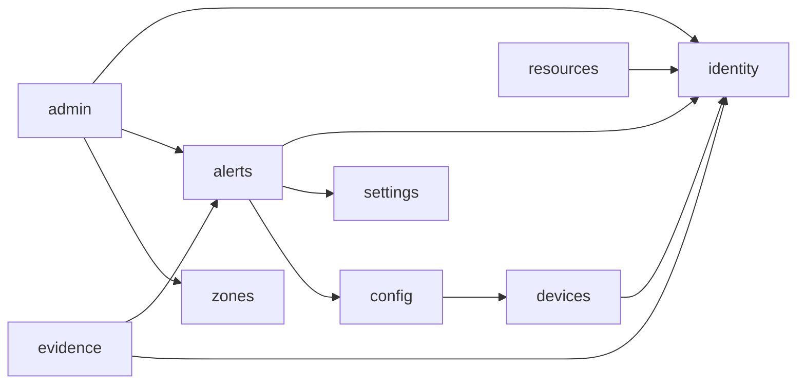

# Monolito modular — ALERTA MUJER

El backend es un **monolito modular**: se despliega como una sola aplicación, pero está dividido en
módulos con fronteras verificadas, preparados para separarse como microservicios.

**Regla:** un módulo solo puede usar de otro su **API pública** (paquete `<módulo>.api`) y el núcleo
compartido (`shared`). Nunca sus entidades, repositorios ni servicios internos, y no puede haber
dependencias circulares. La prueba `ModularityTest` (Spring Modulith, `verify()`) hace fallar el
build si alguien rompe la regla.

## Módulos y dependencias

Todos pueden usar además `shared` (excepciones y datos de la petición). Las dependencias van en una
sola dirección: `identity`, `settings` y `zones` no dependen de ningún otro módulo.

| Módulo | Responsabilidad | API pública | Futuro servicio |
|---|---|---|---|
| `identity` | Personas, cuentas, roles, perfiles, sesión, administración de cuentas | `IdentityApi`, `IdentityAdminApi`, evento `AdminSessionEvent` | Servicio de identidad |
| `alerts` | Alertas SOS, contactos, ubicaciones, rutas, notificaciones, expiración | `AlertsApi` | Servicio de alertas |
| `evidence` | Archivos de evidencia y su revisión | — | Servicio de evidencias |
| `devices` | Dispositivos y tokens push | `DevicesApi` | Servicio de dispositivos |
| `zones` | Zonas del mapa y reportes de zona | `ZonesApi` | Servicio de zonas |
| `resources` | Puntos de ayuda y llamadas | — | Servicio de recursos |
| `settings` | Parámetros globales del sistema | `SettingsApi` | Servicio de configuración |
| `config` | Firebase y envío de notificaciones push | `FcmService` | Servicio de notificaciones |
| `admin` | Panel: compone a los demás, auditoría, moderación, informes | — (consume) | API Gateway / BFF del panel |

**Comunicación por eventos:** `identity` publica `AdminSessionEvent` (inicio, intento fallido, cierre de
sesión, cambio de contraseña) y la auditoría de `admin` lo escucha. En microservicios ese evento
viajaría por una cola de mensajes.

## Base de datos: llaves foráneas a cortar en la migración

Cada módulo ya tiene su esquema, pero estas llaves foráneas cruzan esquemas. Al separar servicios se
reemplazan por el id guardado sin restricción, más una validación por la API del otro servicio:

| Tabla | Columna | Apunta a |
|---|---|---|
| `admin.alert_report` | `created_by_user_id` | `identity.users` |
| `admin.audit_log` | `account_id` | `identity.account` |
| `admin.user_report` | `reporter_user_id`, `reported_user_id` | `identity.users` |
| `alert.alert` | `user_profile_id` · `device_id` | `identity.user_profile` · `identity.device` |
| `alert.emergency_contact`, `frequent_location`, `location_log`, `notification`, `saved_route` | `user_profile_id` | `identity.user_profile` |
| `resource.resource_call` | `user_profile_id` · `device_id` · `alert_id` | `identity.user_profile` · `identity.device` · `alert.alert` |
| `resource.zone_report` | `user_profile_id` | `identity.user_profile` |

Además, algunas tablas están en un esquema distinto al de su módulo de código: `identity.device` (módulo
`devices`), `resource.zone` y `resource.zone_report` (módulo `zones`) y `admin.system_configuration`
(módulo `settings`). Se moverían al esquema de su servicio en la migración.

## Orden sugerido de migración

1. **`zones`** y **`settings`**: no dependen de otros módulos.
2. **`evidence`** y **`resources`**: dependen de `identity`/`alerts` solo por API.
3. **`devices`** y **`config`** (notificaciones).
4. **`alerts`**.
5. **`identity`** al final (todos dependen de ella); `admin` pasa a ser el gateway del panel.

En cada paso, la implementación de la API (`*ApiService`) se reemplaza por un cliente HTTP con la
misma interfaz, y el resto del código no cambia.

Diagramas detallados (PlantUML): se generan con `mvn test` en `backend-monolith/target/spring-modulith-docs`.
