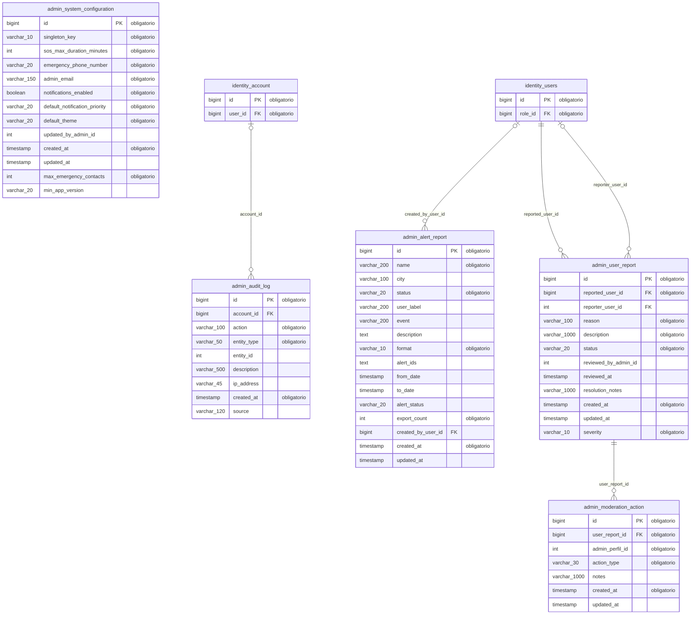
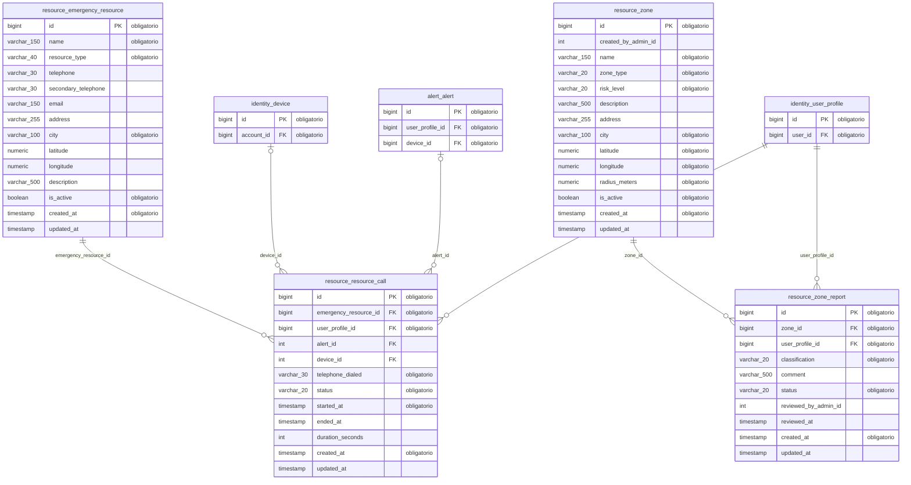

# Modelo entidad-relación — ALERTA MUJER

Generado el 2026-10-15 desde la base PostgreSQL con todas las migraciones Liquibase aplicadas (v1.0.0 a v1.6.0): 29 tablas, 35 relaciones.

- Script de creación: [alerta_mujer_schema.sql](alerta_mujer_schema.sql)
- Imágenes: `modelo_er_completo.svg` y una por esquema (`modelo_er_<esquema>.svg`).
- En cada diagrama de esquema, las tablas de otros esquemas aparecen solo con su llave para mostrar la relación.

Notación: `||--o{` uno a muchos, `||--o|` uno a uno, `|o--o{` relación opcional (la llave foránea admite nulos).

## identity — personas, cuentas, roles, perfiles y sesiones

```mermaid
erDiagram
    identity_account {
        bigint id PK "obligatorio"
        bigint user_id FK "obligatorio"
        varchar_255 password_hash "obligatorio"
        varchar_20 status "obligatorio"
        timestamp last_access
        timestamp updated_at
    }
    identity_admin_profile {
        bigint id PK "obligatorio"
        bigint account_id FK "obligatorio"
        timestamp created_at "obligatorio"
        timestamp updated_at
    }
    identity_alert_activation_setting {
        bigint id PK "obligatorio"
        bigint device_id FK "obligatorio"
        varchar_30 activation_method "obligatorio"
        boolean is_enabled "obligatorio"
        timestamp updated_at "obligatorio"
    }
    identity_device {
        bigint id PK "obligatorio"
        bigint account_id FK "obligatorio"
        varchar_255 device_uuid "obligatorio"
        varchar_255 fcm_token
        varchar_50 brand
        varchar_100 model
        varchar_30 os_name "obligatorio"
        varchar_30 os_version
        varchar_30 app_version
        varchar_20 gps_status "obligatorio"
        varchar_20 status "obligatorio"
        timestamp last_access
        timestamp created_at "obligatorio"
        timestamp updated_at
    }
    identity_device_permission {
        bigint id PK "obligatorio"
        bigint device_id FK "obligatorio"
        varchar_30 permission_type "obligatorio"
        varchar_20 status "obligatorio"
        timestamp updated_at "obligatorio"
    }
    identity_device_session {
        bigint id PK "obligatorio"
        bigint account_id FK "obligatorio"
        bigint device_id FK "obligatorio"
        varchar_255 refresh_token_hash "obligatorio"
        varchar_20 status "obligatorio"
        timestamp expires_at "obligatorio"
        timestamp last_used_at
        timestamp revoked_at
        timestamp created_at "obligatorio"
        timestamp updated_at
    }
    identity_recovery_request {
        bigint id PK "obligatorio"
        bigint account_id FK "obligatorio"
        varchar_20 method "obligatorio"
        varchar_255 token_hash "obligatorio"
        timestamp expires_at "obligatorio"
        timestamp used_at
        varchar_20 status "obligatorio"
        bigint attempts "obligatorio"
        timestamp created_at
        varchar_45 requested_ip
        timestamp updated_at
    }
    identity_role {
        bigint id PK "obligatorio"
        varchar_30 name "obligatorio"
        varchar_255 description
        timestamp updated_at
    }
    identity_user_preference {
        bigint id PK "obligatorio"
        bigint user_profile_id FK "obligatorio"
        varchar_10 language "obligatorio"
        varchar_20 theme "obligatorio"
        timestamp created_at "obligatorio"
        timestamp updated_at
    }
    identity_user_profile {
        bigint id PK "obligatorio"
        bigint user_id FK "obligatorio"
        varchar_500 profile_photo_url
        boolean tutorial_completed "obligatorio"
        timestamp tutorial_seen_at
        timestamp created_at "obligatorio"
        timestamp updated_at
    }
    identity_users {
        bigint id PK "obligatorio"
        bigint role_id FK "obligatorio"
        varchar_100 first_name "obligatorio"
        varchar_100 last_name "obligatorio"
        varchar_20 telephone
        varchar_150 email "obligatorio"
        varchar_20 document_number
        varchar_20 document_type
        date birthdate
        timestamp created_at "obligatorio"
        timestamp updated_at
    }
    admin_alert_report {
        bigint id PK "obligatorio"
        bigint created_by_user_id FK
    }
    admin_audit_log {
        bigint id PK "obligatorio"
        bigint account_id FK
    }
    admin_user_report {
        bigint id PK "obligatorio"
        bigint reported_user_id FK "obligatorio"
        int reporter_user_id FK
    }
    alert_alert {
        bigint id PK "obligatorio"
        bigint user_profile_id FK "obligatorio"
        bigint device_id FK "obligatorio"
    }
    alert_emergency_contact {
        bigint id PK "obligatorio"
        bigint user_profile_id FK "obligatorio"
    }
    alert_frequent_location {
        bigint id PK "obligatorio"
        bigint user_profile_id FK "obligatorio"
    }
    alert_location_log {
        bigint id PK "obligatorio"
        bigint user_profile_id FK "obligatorio"
        int alert_id FK
    }
    alert_notification {
        bigint id PK "obligatorio"
        bigint user_profile_id FK "obligatorio"
        int alert_id FK
    }
    alert_saved_route {
        bigint id PK "obligatorio"
        bigint user_profile_id FK "obligatorio"
    }
    resource_resource_call {
        bigint id PK "obligatorio"
        bigint emergency_resource_id FK "obligatorio"
        bigint user_profile_id FK "obligatorio"
        int alert_id FK
        int device_id FK
    }
    resource_zone_report {
        bigint id PK "obligatorio"
        bigint zone_id FK "obligatorio"
        bigint user_profile_id FK "obligatorio"
    }
    identity_users |o--o{ admin_alert_report : "created_by_user_id"
    identity_account |o--o{ admin_audit_log : "account_id"
    identity_users ||--o{ admin_user_report : "reported_user_id"
    identity_users |o--o{ admin_user_report : "reporter_user_id"
    identity_device ||--o{ alert_alert : "device_id"
    identity_user_profile ||--o{ alert_alert : "user_profile_id"
    identity_user_profile ||--o{ alert_emergency_contact : "user_profile_id"
    identity_user_profile ||--o{ alert_frequent_location : "user_profile_id"
    identity_user_profile ||--o{ alert_location_log : "user_profile_id"
    identity_user_profile ||--o{ alert_notification : "user_profile_id"
    identity_user_profile ||--o{ alert_saved_route : "user_profile_id"
    identity_users ||--o{ identity_account : "user_id"
    identity_account ||--o{ identity_admin_profile : "account_id"
    identity_device ||--o{ identity_alert_activation_setting : "device_id"
    identity_account ||--o{ identity_device : "account_id"
    identity_device ||--o{ identity_device_permission : "device_id"
    identity_device ||--o{ identity_device_session : "device_id"
    identity_account ||--o{ identity_device_session : "account_id"
    identity_account ||--o{ identity_recovery_request : "account_id"
    identity_user_profile ||--o{ identity_user_preference : "user_profile_id"
    identity_users ||--o{ identity_user_profile : "user_id"
    identity_role ||--o{ identity_users : "role_id"
    identity_device |o--o{ resource_resource_call : "device_id"
    identity_user_profile ||--o{ resource_resource_call : "user_profile_id"
    identity_user_profile ||--o{ resource_zone_report : "user_profile_id"
```

## alert — alertas SOS, contactos, ubicaciones, evidencias y notificaciones

```mermaid
erDiagram
    alert_alert {
        bigint id PK "obligatorio"
        bigint user_profile_id FK "obligatorio"
        bigint device_id FK "obligatorio"
        varchar_20 alert_type "obligatorio"
        varchar_30 activation_method "obligatorio"
        varchar_20 status "obligatorio"
        varchar_500 message
        numeric latitude
        numeric longitude
        timestamp started_at "obligatorio"
        timestamp ended_at
        timestamp cancelled_at
        timestamp created_at "obligatorio"
        timestamp updated_at
    }
    alert_alert_contact {
        bigint id PK "obligatorio"
        bigint alert_id FK "obligatorio"
        bigint emergency_contact_id FK "obligatorio"
        varchar_20 channel "obligatorio"
        varchar_150 destination "obligatorio"
        varchar_20 status "obligatorio"
        timestamp sent_at
        timestamp delivered_at
        bigint attempts "obligatorio"
        varchar_500 error_message
        timestamp created_at "obligatorio"
        timestamp updated_at
    }
    alert_alert_reminder {
        bigint id PK "obligatorio"
        bigint alert_id FK "obligatorio"
        varchar_20 reminder_type "obligatorio"
        int sequence_number "obligatorio"
        timestamp scheduled_at "obligatorio"
        timestamp sent_at
        varchar_20 status "obligatorio"
        varchar_500 error_message
        timestamp created_at "obligatorio"
        timestamp updated_at
    }
    alert_emergency_contact {
        bigint id PK "obligatorio"
        bigint user_profile_id FK "obligatorio"
        varchar_100 contact_name "obligatorio"
        varchar_20 telephone "obligatorio"
        varchar_150 email
        varchar_30 relationship
        timestamp created_at "obligatorio"
        timestamp updated_at
    }
    alert_evidence {
        bigint id PK "obligatorio"
        bigint alert_id FK "obligatorio"
        varchar_20 media_type "obligatorio"
        varchar_255 file_url "obligatorio"
        timestamp created_at "obligatorio"
        timestamp updated_at
        varchar_255 file_name
        varchar_100 content_type
        bigint size_bytes
        character_64 sha256
        varchar_100 storage_key
        varchar_20 review_status "obligatorio"
    }
    alert_frequent_location {
        bigint id PK "obligatorio"
        bigint user_profile_id FK "obligatorio"
        varchar_100 name "obligatorio"
        varchar_255 address
        varchar_100 city
        numeric latitude "obligatorio"
        numeric longitude "obligatorio"
        varchar_255 notes
        varchar_20 risk_level "obligatorio"
        boolean is_active "obligatorio"
        timestamp created_at "obligatorio"
        timestamp updated_at
    }
    alert_location_log {
        bigint id PK "obligatorio"
        bigint user_profile_id FK "obligatorio"
        int alert_id FK
        numeric latitude "obligatorio"
        numeric longitude "obligatorio"
        numeric accuracy
        timestamp recorded_at "obligatorio"
    }
    alert_notification {
        bigint id PK "obligatorio"
        bigint user_profile_id FK "obligatorio"
        int alert_id FK
        varchar_30 type "obligatorio"
        varchar_20 priority "obligatorio"
        varchar_100 title "obligatorio"
        varchar_500 message "obligatorio"
        boolean is_read "obligatorio"
        boolean is_persistent "obligatorio"
        timestamp expires_at
        timestamp created_at "obligatorio"
        timestamp updated_at
    }
    alert_saved_route {
        bigint id PK "obligatorio"
        bigint user_profile_id FK "obligatorio"
        varchar_150 name "obligatorio"
        varchar_150 start_label
        varchar_150 end_label
        varchar_100 city
        varchar_100 department
        varchar_100 country
        numeric distance_km
        int estimated_minutes
        jsonb points "obligatorio"
        boolean is_starred "obligatorio"
        boolean is_manual "obligatorio"
        timestamp created_at "obligatorio"
        timestamp updated_at
    }
    identity_device {
        bigint id PK "obligatorio"
        bigint account_id FK "obligatorio"
    }
    identity_user_profile {
        bigint id PK "obligatorio"
        bigint user_id FK "obligatorio"
    }
    resource_resource_call {
        bigint id PK "obligatorio"
        bigint emergency_resource_id FK "obligatorio"
        bigint user_profile_id FK "obligatorio"
        int alert_id FK
        int device_id FK
    }
    identity_device ||--o{ alert_alert : "device_id"
    identity_user_profile ||--o{ alert_alert : "user_profile_id"
    alert_emergency_contact ||--o{ alert_alert_contact : "emergency_contact_id"
    alert_alert ||--o{ alert_alert_contact : "alert_id"
    alert_alert ||--o{ alert_alert_reminder : "alert_id"
    identity_user_profile ||--o{ alert_emergency_contact : "user_profile_id"
    alert_alert ||--o{ alert_evidence : "alert_id"
    identity_user_profile ||--o{ alert_frequent_location : "user_profile_id"
    identity_user_profile ||--o{ alert_location_log : "user_profile_id"
    alert_alert |o--o{ alert_location_log : "alert_id"
    alert_alert |o--o{ alert_notification : "alert_id"
    identity_user_profile ||--o{ alert_notification : "user_profile_id"
    identity_user_profile ||--o{ alert_saved_route : "user_profile_id"
    alert_alert |o--o{ resource_resource_call : "alert_id"
```

## admin — configuración, auditoría, moderación e informes

## resource — zonas y puntos de ayuda

